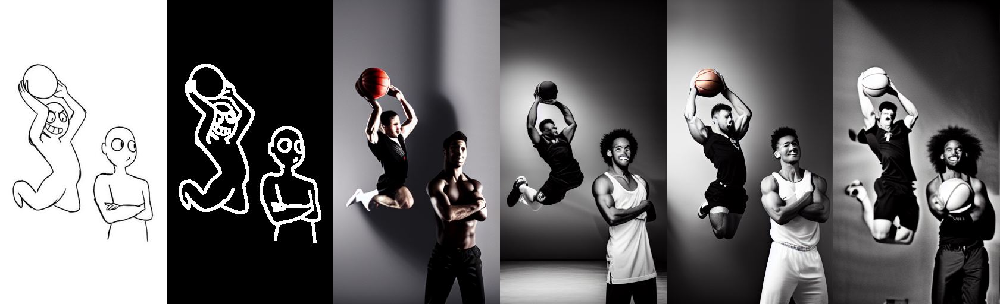
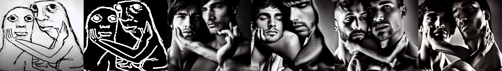
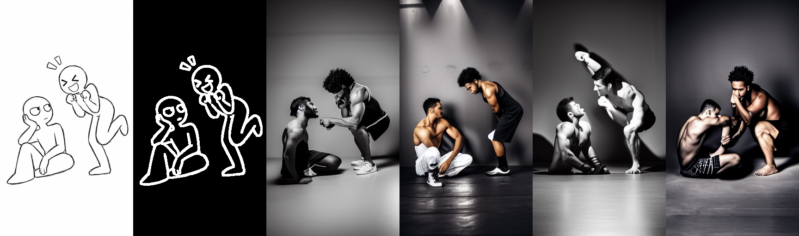
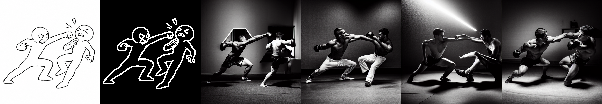
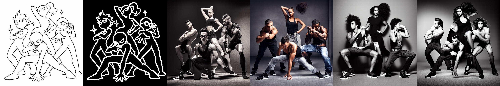
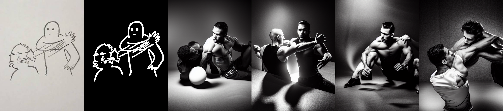
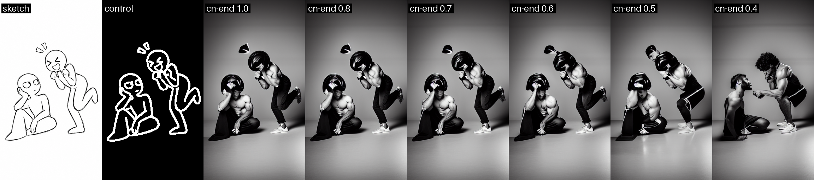
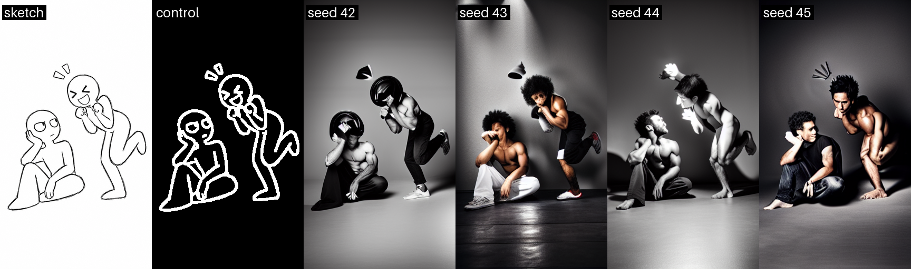

# GigaSketch: Sketch-to-Image with Stable Diffusion + ControlNet

Turn rough hand-drawn sketches into polished images while keeping their structure (pose, composition).
The default style turns simple stick-figure / meme sketches into dramatic, black-and-white "gigachad"
photos.



## How it works

```
sketch photo ──► preprocessing (OpenCV) ──► scribble map ──► ControlNet ──┐
                                                                          ├──► Stable Diffusion 1.5 ──► image
text prompt  ──► template: content + style preset + quality tags ─────────┘
```

1. **Preprocessing** (`prepare_sketch`): the sketch is resized (longest side 512, multiple of 8), binarised with an adaptive threshold so that uneven lighting / paper texture disappear.
   Lines become white on black, which is the format the Scribble ControlNet was trained on.
   Small specks are removed (morphological opening) and strokes are thickened (dilation).
2. **ControlNet Scribble** (`lllyasviel/control_v11p_sd15_scribble`) is a trainable copy of the SD encoder that
   reads the scribble map and adds its features to the SD U-Net at every denoising step. This is how the
   sketch controls the layout of the generated image.
3. **Stable Diffusion 1.5** generates the image from the text prompt, guided by ControlNet.
   UniPC scheduler, 20 steps, fp16.
4. **Prompt template**: the user only describes *what is in the sketch* (subjects + action). The script adds a
   style preset and quality tags, and builds the negative prompt the same way:
   `"{content}, {style preset}, highly detailed, sharp focus, best quality"`.

### Main settings

| Setting | Default | Meaning |
|---|---|---|
| `--scale` | 1.0 | ControlNet strength: how strictly the sketch lines are followed |
| `--cn-end` | **0.4** | ControlNet is only active during the first 40% of the steps (`control_guidance_end`) |
| `--guidance` | 7.5 | Classifier-free guidance: how strongly the prompt is followed |
| `--steps` | 20 | Denoising steps (UniPC) |
| `--seeds` | 42 | One or more seeds |
| `--style` | gigachad | Style preset: `gigachad`, `photo`, `anime`, `comic`, `none` |

**`--cn-end` is a trade-off between pose and face preservation.** These sketches have big, empty round heads.
With ControlNet active for the whole run, the pose is followed closely, but SD often draws the heads literally as
round objects (helmets, bowls, glass spheres). Stable Diffusion decides large shapes in the early steps and details
in the late steps, so stopping ControlNet early leaves the last steps free to draw real faces, at the cost of a
looser pose. 0.4 is the default because it is the highest value where the heads reliably become faces; use a
higher value (e.g. 0.5 or 1.0) when the pose matters more (see [Experiments](#experiments)).

## Setup

Tested on Windows 11, NVIDIA RTX 4060 Laptop (8 GB VRAM), Python 3.11, CUDA 12.6.

```bash
conda create -n gigasketch python=3.11 -y
conda activate gigasketch
pip install torch torchvision --index-url https://download.pytorch.org/whl/cu126
pip install -r requirements.txt
```

Tested versions: torch 2.14.1+cu126, diffusers 0.43.0, transformers 5.23.0, accelerate 1.16.0,
opencv-python 5.1.0, pillow 13.0.0.

The model weights (~5 GB) are downloaded from Hugging Face automatically on the first run.

## Usage

Run from the repo root:

```bash
# one image
python src/generate.py --sketch sketches/m4.png --prompt "two men fighting, one throwing a punch to the face of the other man who recoils in pain"

# several seeds (model loaded once) + a grid image
python src/generate.py --sketch sketches/m4.png --prompt "..." --seeds 42 43 44 45

# another style, other settings
python src/generate.py --sketch sketches/m5.jpg --prompt "..." --style anime --scale 0.8 --cn-end 1.0
```

The full prompt and negative prompt are printed on every run. Results go to `outputs/<sketch name>/`:

- `<name>.png`: generated image
- `<name>_compare.png`: sketch | control map | result, side by side
- `<name>_seeds<...>_grid.png`: sketch | control map | one result per seed (only with 2+ seeds)

File names contain the settings, e.g. `m4_gigachad_s1.0_e0.4_g7.5_seed43.png`
(style, scale, cn-end, guidance, seed).

### Reproduce the final results

All with the default settings (gigachad, scale 1.0, cn-end 0.4, guidance 7.5, 20 steps):

| Sketch | `--prompt` |
|---|---|
| m1 | `two men close together, one man holding the other man's cheek with his hand` |
| m2 | `man slapping another man` |
| m3 | `two men, one sitting on the ground resting his cheek on his hand looking bored, the other leaning toward him laughing excitedly with fists clenched` |
| m4 | `two men fighting, one throwing a punch to the face of the other man who recoils in pain` |
| m5 | `two men, one jumping and holding a basketball over his head with an excited grin, the other standing with arms crossed looking at him` |
| m6 | `three men and one woman striking cool confident poses, a man with spiky hair and arms crossed, a woman with a ponytail, a man adjusting his glasses, a man crouching in front` |

```bash
python src/generate.py --sketch sketches/m1.jpg --prompt "<prompt from the table>" --seeds 42 43 44 45
```

## Results

Each row: original sketch | control map | seeds 42, 43, 44, 45.

**m1**: holding cheek


**m3**: bored + laughing


**m4**: punch


**m5**: basketball


**m6**: group pose


**m2**: slap (failure case)


## Experiments

All runs are kept in `outputs/<sketch>/`; the settings are in the file names.

1. **ControlNet scale (1.0 vs 1.3).** 1.3 was worse on every sketch: following the lines more strictly makes
   cartoon features (round heads, dot eyes) turn into objects even more. 1.0 is the default.
2. **Prompt describing the action.** Without it, SD does not know what the lines mean (m2's motion lines became
   objects). The template keeps style and quality tags fixed, so only the content changes between sketches.
3. **Negative prompt** (`helmet, mask, hat, covered face`). On its own it did **not** fix the helmet heads.
4. **ControlNet end (`--cn-end` 1.0 / 0.8 / 0.7 / 0.6 / 0.5 / 0.4).** 1.0 to 0.6 give almost the same image: the
   layout, heads included, is decided in roughly the first half of the steps. Everything changes between 0.5 and
   0.4. At 0.4 the heads become real faces (m3, m6), but pose details are lost (m3's hand on the cheek and kicked
   leg, m4's recoiling victim turns away). There is no single best value per sketch: m4 looks best at 0.5, m6 only
   works at 0.4, m1 and m5 work everywhere. The helmets at high cn-end also depend on the seed (for m3 at 1.0, only
   seed 42 of 42–45 gave helmets). So cn-end is a **trade-off between pose and face preservation**.

   

   m3 at `--cn-end 1.0` over 4 seeds: only seed 42 turns the heads into helmets; the others keep real heads and
   the pose is closer to the sketch than at 0.4.

   

5. **Seeds (42–45).** With cn-end 0.4: m1, m4, m5 keep the pose in 4/4 seeds; m3 and m6 in 3–4/4;
   m2 in 0/4.
6. **Redrawing the sketches.** Earlier versions of m3/m4 with oversized heads and grid-like teeth failed. Redrawn
   as clean full-body line art (like m5), the poses came through almost perfectly.

### Limitations

- **Messy sketches with symbols** (m2): motion lines, impact stars and "!" marks are drawn as real objects, and the
  slap action is not recognised in any seed.
- **Exaggerated cartoon features** can still turn into odd details (spiky hair → hair blobs, extra ball).
- **Pose vs. face trade-off:** a lower `--cn-end` gives real faces instead of round objects, but follows the pose
  less closely; a higher one keeps the pose but can turn round heads into objects. No single value is best for
  every sketch and seed.
- SD 1.5 works best around 512 px; small sketches (m1 is 241×209) are upscaled first.

## Project structure

```
sketches/      input sketches (m1–m6)
src/
  generate.py  preprocessing, prompt template, pipeline, CLI
outputs/       results, one folder per sketch
```

## References

- **Stable Diffusion 1.5**: [`stable-diffusion-v1-5/stable-diffusion-v1-5`](https://huggingface.co/stable-diffusion-v1-5/stable-diffusion-v1-5)
  ; Rombach et al., *High-Resolution Image Synthesis with Latent Diffusion Models*, CVPR 2022.
- **ControlNet v1.1 Scribble**: [`lllyasviel/control_v11p_sd15_scribble`](https://huggingface.co/lllyasviel/control_v11p_sd15_scribble)
  ; Zhang, Rao & Agrawala, *Adding Conditional Control to Text-to-Image Diffusion Models*, ICCV 2023.
- **UniPC scheduler**: Zhao et al., *UniPC: A Unified Predictor-Corrector Framework for Fast Sampling of Diffusion Models*, NeurIPS 2023.
- **Libraries**: [🤗 Diffusers](https://github.com/huggingface/diffusers), [🤗 Transformers](https://github.com/huggingface/transformers),
  [Accelerate](https://github.com/huggingface/accelerate), [PyTorch](https://pytorch.org/),
  [OpenCV](https://opencv.org/), [Pillow](https://python-pillow.org/).

### Sketches

- `sketches/m1.jpg`: internet meme
- `sketches/m2.jpg`: internet meme
- `sketches/m3.png`, `m4.png`, `m5.jpg`, `m6.png`: drawn
